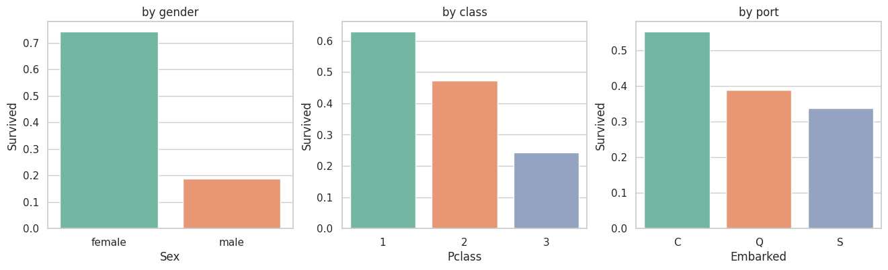
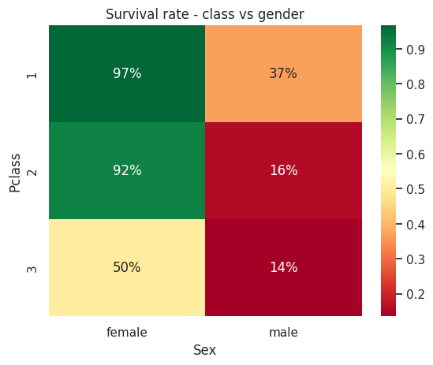
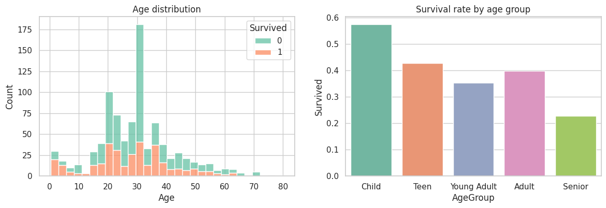
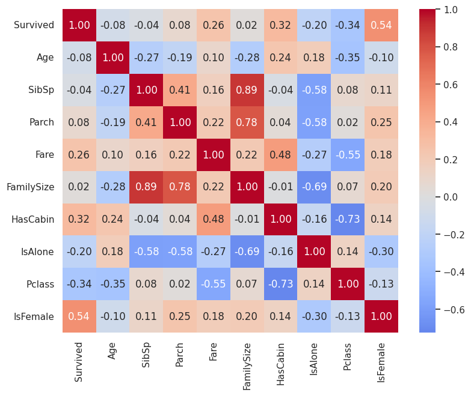

# Task 2 - Titanic EDA

Exploratory data analysis on the Titanic dataset to see which factors affected passenger survival.

**Dataset:** [Titanic - Machine Learning from Disaster](https://www.kaggle.com/c/titanic/data) (Kaggle) - `train.csv`, 891 passengers

**Tools:** Python, pandas, matplotlib, seaborn (Google Colab)

## What I did
- Checked data types, missing values and summary statistics
- Cleaning:
  - `Age` (20% missing) filled with the median age of each title (Mr, Mrs, Miss, Master)
  - `Embarked` (2 missing) filled with the most common port
  - `Cabin` (77% missing) replaced with a `HasCabin` flag
  - converted text columns to category type
- New features: `Title`, `FamilySize`, `IsAlone`, `AgeGroup`
- Survival rates by gender, class, port, title, age group and family size
- Bonus: bar plots of survival rates + heatmaps (class x gender, correlations)

## Charts

## Insights
- Only 38.4% of passengers survived (342 of 891)
- Gender was the biggest factor: 74.2% of women survived vs 18.9% of men
- 1st class 63%, 2nd class 47.3%, 3rd class 24.2%
- 97% of 1st class women survived, only 13.5% of 3rd class men
- Kids (12 and under) 57.5% survival, people over 60 only 22.7%
- Travelling alone: 30.4% vs 50.6% with family, but big families (5+) did badly
- Passengers with a recorded cabin: 66.7% vs 30%

Survival mostly came down to gender and class.

## Run it
Open `Titanic_EDA.ipynb` in Jupyter or Google Colab and run all cells.
