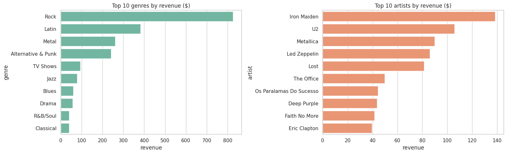
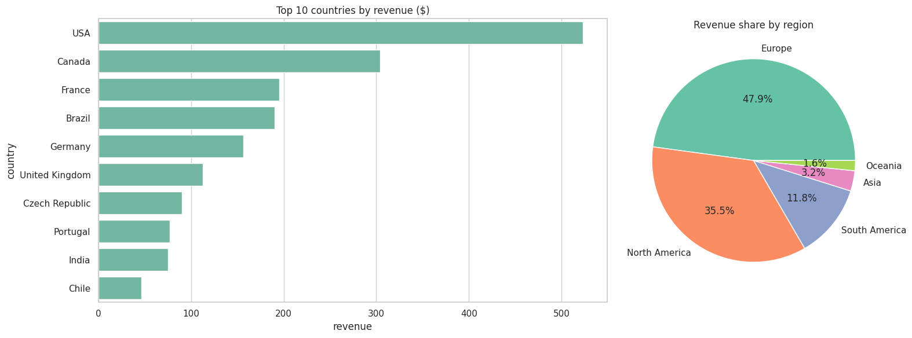
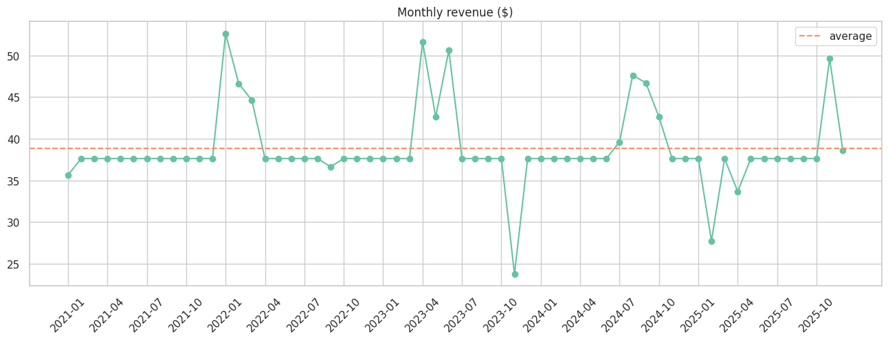

# Task 5 - SQL Analysis of Product Sales (Chinook)

Using SQL to analyse the sales of a digital music store.

**Dataset:** Chinook Database (SQLite) - 11 tables, 412 invoices, 59 customers, 2021-2025

**Tools:** SQLite, Python (pandas, matplotlib, seaborn), Google Colab

## Business questions
1. What are the top-selling products?
2. How much revenue comes from each region?
3. How do sales perform month by month?

## What I did
- JOINs between `InvoiceLine`, `Track`, `Album`, `Artist` and `Genre` to get product sales
- Top tracks, genres, artists and albums by revenue
- Revenue per country and per continent (`CASE WHEN`)
- Monthly and yearly revenue, best and worst months, seasonality
- Bonus - window functions:
  - `RANK()` to rank countries and customers
  - `ROW_NUMBER()` to find the best-selling artist in each genre
  - `LAG()` for year over year growth
  - `SUM() OVER` for a running total

## Charts

## Insights
- Rock is the biggest genre with 35.5% of revenue, then Latin (16.4%), Metal (11.2%) and Alternative & Punk (10.4%)
- Iron Maiden is the best-selling artist ($138.60), then U2, Metallica and Led Zeppelin
- USA brings the most revenue ($523.06), then Canada, France, Brazil and Germany
- Europe is the biggest region (47.9%), then North America (35.5%)
- Revenue per customer is about the same everywhere ($37-46), so bigger countries just have more customers
- Sales are very stable (most months $37.62) with no real growth over 5 years

## Files
- `Chinook_SQL_Analysis.ipynb` - the full analysis (SQL run from Python + charts)
- `queries.sql` - all the SQL queries on their own

## Run it
- Open `Chinook_SQL_Analysis.ipynb` in Google Colab or Jupyter and run all cells. The database is downloaded automatically.
- Or run `queries.sql` directly on the [Chinook SQLite database](https://github.com/lerocha/chinook-database) using DB Browser for SQLite or any SQL editor.
