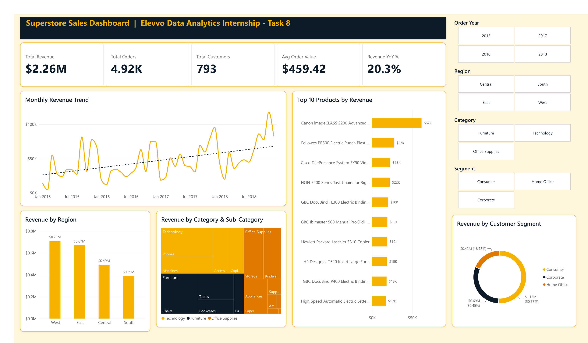

# Task 8 - Power BI Dashboard for Retail Insights

Interactive Power BI dashboard built on the Superstore sales data.

**Dataset:** [Superstore Sales Dataset](https://www.kaggle.com/datasets/rohitsahoo/sales-forecasting) (Kaggle) - 9,800 orders, 2015-2018

**Tools:** Python (pandas) for cleaning, Power BI Desktop for the dashboard



## Data cleaning (`clean_superstore.py`)
- Converted Order Date and Ship Date from text (dd/mm/yyyy) to real dates
- Filled 11 missing Postal Codes (all Burlington, Vermont -> 05401) and kept them as text
- Removed 1 duplicate row
- Added `Ship Days`, `Order Year` and `Order Month` columns

## Dashboard
- **KPIs:** Total Revenue, Total Orders, Total Customers, Avg Order Value, Revenue YoY %
- **Top 10 products** by revenue (Top N filter)
- **Sales by region** and **revenue by category / sub-category** (treemap)
- **Monthly revenue trend** with a trend line
- **Revenue by customer segment** (donut)
- **Slicers:** Order Year, Region, Category, Segment - everything on the page filters together
- Custom theme in Elevvo colors (`elevvo_theme.json`)

DAX measures:
```DAX
Total Revenue = SUM(Sales[Sales])
Total Orders = DISTINCTCOUNT(Sales[Order ID])
Total Customers = DISTINCTCOUNT(Sales[Customer ID])
Avg Order Value = DIVIDE([Total Revenue], [Total Orders])
Avg Ship Days = AVERAGE(Sales[Ship Days])
Revenue YoY % = VAR cy = MAX(Sales[Order Year]) VAR cur = CALCULATE([Total Revenue], Sales[Order Year] = cy) VAR prev = CALCULATE([Total Revenue], Sales[Order Year] = cy - 1) RETURN DIVIDE(cur - prev, prev)
```

## Insights
- Total revenue is $2.26M from 4,922 orders and 793 customers (avg order $459)
- Revenue grew strongly in the last two years: $459K in 2016 -> $600K in 2017 -> $722K in 2018 (+20.3%)
- West is the top region (31.4%), South the smallest (17.2%)
- Technology brings the most revenue (36.6%), Phones and Chairs are the top sub-categories
- Consumers are half of all sales (50.8%)
- The Canon imageCLASS 2200 copier is by far the top product ($62K)

## Files
- `Superstore_Sales_Dashboard.pbix` - the Power BI file (open with Power BI Desktop)
- `Superstore_Sales_Dashboard.pdf` / `dashboard.png` - exported dashboard
- `clean_superstore.py` - cleaning script
- `data/superstore_clean.csv` - cleaned data used in Power BI
